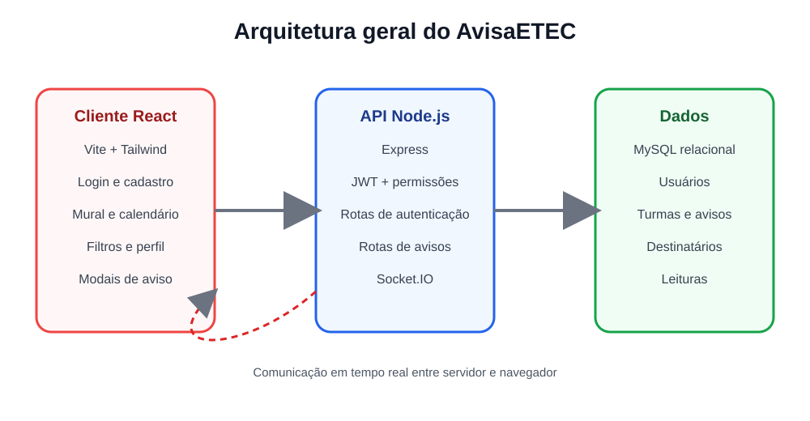
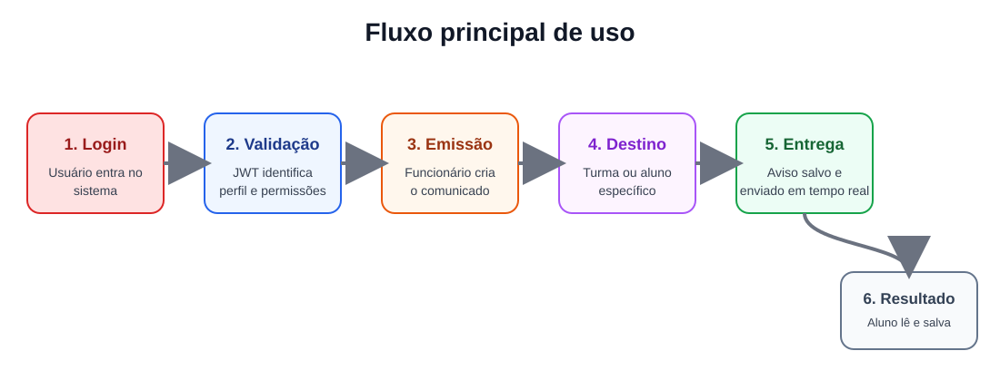
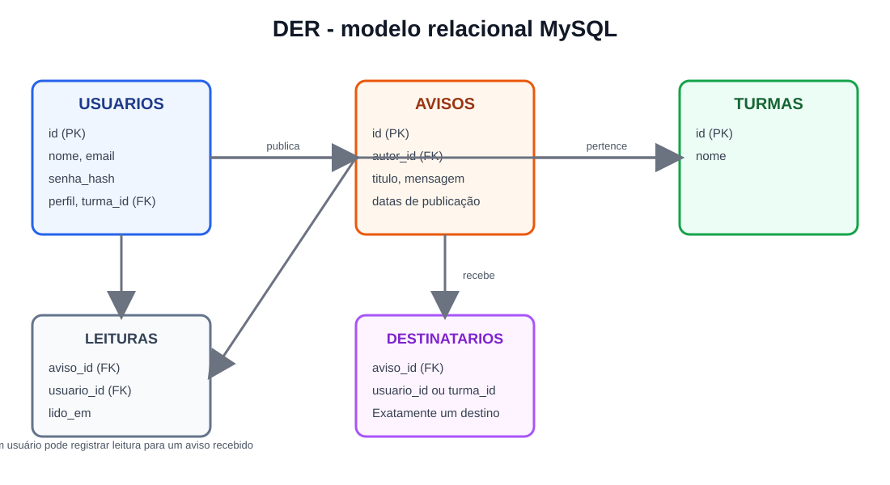

# AvisaETEC - resumo para apresentação do protótipo

## 1. Ideia do projeto

O **AvisaETEC** é um sistema de comunicação escolar que centraliza avisos, calendário acadêmico e notificações para alunos e funcionários da ETEC.

**Problema:** avisos importantes circulam por canais descentralizados ou papel, dificultando o alcance e a confirmação da informação.  
**Objetivo:** permitir que alunos recebam comunicados oficiais de forma rápida e organizada, enquanto funcionários autorizados segmentam mensagens por turma ou aluno.

---

## 2. Etapas construídas

| Etapa | O que foi feito |
|---|---|
| 1. Gestão e escopo | Problema, público, objetivo, limites e necessidades do projeto foram definidos. |
| 2. Requisitos | Perfis, requisitos funcionais, não funcionais e regras de negócio foram documentados. |
| 3. Arquitetura | Projeto dividido em front-end React, API Node.js/Express e banco MySQL. |
| 4. Modelagem de dados | Modelo conceitual, lógico e DER criados para usuários, turmas, avisos, destinatários e leituras. |
| 5. Protótipo visual | Telas de login, cadastro, mural, calendário, perfil, filtros e emissão de avisos implementadas. |
| 6. API e segurança | Login JWT, hash de senhas, permissões, validação e limites contra abuso preparados no servidor. |
| 7. Organização técnica | Monorepo com `client`, `server` e `docs`, além de execução conjunta dos ambientes. |

---

## 3. Arquitetura do sistema

**Explicação curta:** o aluno ou funcionário usa o navegador React. A interface envia operações à API Express. O servidor valida autenticação e permissões, consulta o banco ou a camada de dados e usa Socket.IO para entregar eventos em tempo real.

---

## 4. Perfis e responsabilidades

| Perfil | Pode fazer |
|---|---|
| Aluno | Entrar, visualizar mural e calendário, marcar leitura e salvar avisos. |
| Professor | Tudo que o aluno faz e emitir avisos para turma ou aluno, além de editar/excluir seus próprios avisos. |
| Coordenador | Comunicação autorizada para turmas ou alunos dentro de sua área. |
| Administrador | Visão global e gestão dos avisos de acordo com suas permissões. |

**Conta de demonstração:** `professor` usa `rafael.martins@demo.avisaetec.local` com senha `demo123`.  
**Conta de aluno:** `beatriz.almeida@demo.avisaetec.local`, também com senha `demo123`.

---

## 5. Fluxo principal

1. O usuário entra no sistema.
2. O servidor autentica os dados e envia o perfil/permissões.
3. O aluno recebe avisos no mural.
4. Um funcionário autorizado cria um aviso e seleciona turma ou aluno.
5. O servidor valida o destino e a permissão.
6. O aviso é salvo e distribuído em tempo real.
7. O aluno visualiza, marca como lido ou salva o comunicado.

---

## 6. Funcionalidades do protótipo

- Login e cadastro demonstrativo.
- Acesso rápido com perfil de aluno e professor.
- Mural com avisos recentes.
- Categorias: Urgente, Minha turma, Para mim e Acadêmico.
- Filtro de todos, não lidos e categorias.
- Marcar aviso como lido e adicionar aos salvos.
- Calendário mensal com dias letivos e eventos.
- Modo claro e modo escuro.
- Perfil acadêmico editável.
- Menu lateral em computadores e navegação inferior em dispositivos menores.
- Emissão de avisos por perfil autorizado.
- Seleção de destinatário por turma/módulo ou aluno.
- Modal de confirmação após a publicação.
- Edição e exclusão somente pelo autor ou administrador autorizado.

---

## 7. Regras de negócio

- Apenas usuários autorizados podem emitir avisos.
- O perfil Aluno não possui permissão de escrita.
- Todo aviso precisa possuir um destino: turma **ou** aluno.
- Uma senha nunca é armazenada em texto aberto; usa hash seguro.
- A leitura é registrada individualmente para cada usuário.
- O autor pode editar ou excluir apenas seus avisos.
- O Administrador pode gerenciar avisos conforme autorização.
- Avisos e destinatários são normalizados em tabelas relacionais.

---

## 8. Modelo de dados

**Entidades principais:**

- `usuarios`: dados pessoais, perfil e vínculo com uma turma.
- `turmas`: módulo/turma da ETEC.
- `avisos`: título, mensagem, autor e datas.
- `avisos_destinatarios`: associa cada aviso a uma turma ou usuário.
- `avisos_leituras`: registra quando cada usuário leu um aviso.

O desenho evita listas ou objetos JSON dentro de tabelas e permite integridade referencial, auditoria e consultas SQL.

---

## 9. Segurança implementada

- Autenticação por JWT.
- Hash de senha com bcryptjs.
- Permissão `notifications:emit` para emissão de avisos.
- Validação do autor antes de editar ou excluir.
- Cabeçalhos protegidos pelo Helmet.
- Limite de requisições por IP, usuário e ação.
- Limite específico para tentativas de login e emissão.
- Corpo da requisição limitado a 100 KB.
- Socket.IO protegido por token JWT.
- Resposta HTTP `429` e `Retry-After` quando o limite é excedido.

---

## 10. Estado atual do protótipo

**Já concluído:** interface visual, navegação, filtros, perfil, calendário, modais, regras de interface, API REST, autenticação, permissões, Socket.IO e modelagem MySQL.

**Ainda demonstrativo:** o front-end atual usa dados locais; login e avisos ainda não estão totalmente ligados à API.

**Próximo passo:** ligar o React à API e ao Socket.IO, configurar MySQL e executar o esquema SQL antes da publicação.

---

## 11. Telas do protótipo

### Tela de login

### Mural do professor

### Modal de emissão de aviso

---

## 12. Roteiro curto para apresentar

1. **Problema:** explique por que avisos escolares precisam de centralização.
2. **Solução:** apresente o mural como ponto único de comunicação.
3. **Perfis:** diferencie aluno de funcionário autorizado.
4. **Fluxo:** escolha o perfil Professor, abra o modal e envie um aviso.
5. **Segmentação:** mostre que o aviso pode ir para turma ou aluno.
6. **Calendário:** demonstre a integração com datas acadêmicas.
7. **Segurança:** cite JWT, hash, permissões e validação de autoria.
8. **Banco:** explique as entidades e o DER.
9. **Próximos passos:** integração completa, MySQL e publicação.
